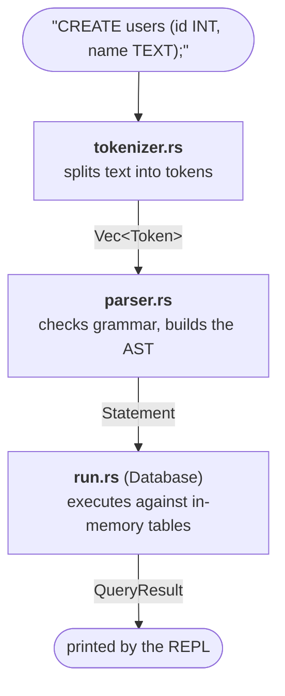

# Mini SQL Engine 

A mini SQL Engine on Rust 

## Structure 

A query goes through three stages, each in its own module:

## Files 
|Module|Responsibility|
|---|---|
| `main.rs`|REPL loop (`rustyline`)
| `lib.rs` | `execute()`: puts together the flow |
| `tokenizer.rs`|Text -> `Vec<Token>` |
| `parser.rs` | `Vec<Token>` -> `Statement` |
| `run.rs` | `Statement` -> `QueryResult` |
| `core.rs` | `Table`, `Column`, `Value`, `DataType` |
| `error.rs` | `SqlError`|

## Core functionality (temporal plan)

- [x] Store data in memory (one table, typed columns, `CREATE TABLE`, `INSERT`, `INT`, `FLOAT`, `TEXT`, `BOOL`)
- [x] Interactive terminal (REPL)
- [x] Own error type (`SqlError` enum) instead of `String` errors
- [ ] `SELECT` with column lists, `*`, aliases, `DISTINCT`
- [ ] `WHERE` with basic operators (`=`, `!=`, `<`, `>`, `AND`, `OR`, `NOT`, `IS NULL`)
- [ ] `ORDER BY` and `LIMIT`
- [ ] Aggregates: `COUNT`, `SUM`, `AVG`, `MIN`, `MAX`
- [ ] `GROUP BY` and `HAVING`
- [ ] NULL handling (three-valued logic)
- [ ] `UPDATE` and `DELETE`
- [ ] Persist data to disk (and load from CSV)
- [ ] Multiple tables in one database
- [ ] `PRIMARY KEY` and `FOREIGN KEY` (checked on `INSERT`, `UPDATE`, `DELETE`)
- [ ] Table aliases and qualified columns (`a.id`)
- [ ] `INNER JOIN` and `LEFT JOIN`
- [ ] `EXPLAIN`

## Constraints 

- Allowed libraries: `rustyline` (REPL), `csv`
- No `unwrap`, `expect`, `unsafe`.
- Testing 
